# AVATimePilot

[](https://github.com/Harlock123/AVATimePilot/actions/workflows/build.yml)

A free-flying dogfight shooter in the style of Konami's 1982 arcade game **Time Pilot**, built with
.NET 10 and Avalonia UI. Your plane is always in the middle of the screen and never stops flying; the
sky, the clouds and the enemy wheel around you as you turn. Shoot down forty of the enemy and their
great ship comes out. Bring that down and you're thrown through a time warp into the next era.

## Features

- **Sixteen-way flying**: the stick points the way you want to go and the plane banks round to it a
  step at a time, the short way round. You never stop, so you fight by turning.
- **Five eras**, each with its own sky, its own enemy craft and its own great ship:

  | Era | The enemy | The great ship |
  |-----|-----------|----------------|
  | **1917**, The Great War | Biplanes | An airship |
  | **1943**, The War in the Air | Monoplane fighters | A four-engined heavy bomber |
  | **1966**, The Rotor Age | Helicopters that hover and fire homing missiles | A twin-rotor gunship |
  | **1988**, The Jet Age | Jets, fast in a straight line and wide in the turn, with missiles | A swept-wing stratobomber |
  | **2061**, The Saucer Wars | Saucers that jink about and fire energy bolts | The mothership |

  After 2061 the eras come round again, faster and fiercer, with tougher great ships.
- **Dogfights**:
  - **Passes**: enemies come at you, make their pass and swing round for another.
  - **Formations**: five planes fly straight through together. Shoot all five for a bonus.
  - **The great ship**: it takes many hits, fires spreads of shot, and an arrow at the screen's edge
    points to it when it's out of sight. If it gets away, it comes back.
  - **Missiles**: they home in on you. Out-turn them or shoot them down.
- **Parachutists** drift down from time to time. Fly through them to catch them: 1,000 points for the
  first, rising to 5,000.
- **Three layers of cloud**: far ones drift slowly beneath you, and near ones rush past over everything,
  hiding enemies for a moment.
- **The time warp**: down the great ship and the sky winds itself into a spiral as you go through.
- **Sound**: an original flying tune over the engine's hum, the guns, explosions, missiles, the
  warning siren, the warp and the rescue chime, all mixed by OpenAL.
- **Attract mode**: leave the title alone for 15 seconds and a computer pilot flies a demonstration.
  It dodges shots and missiles, swings round onto the nearest enemy, leads its shots, catches
  parachutists and takes on the great ship. The tests make it get through the first era more often
  than not.
- **A top-ten high-score table** with arcade-style initials entry; it records the furthest era
  reached.
- **Gamepads** through SDL2, as well as the keyboard.
- **Any window size**: the screen scales to fit, letterboxed. **Ctrl+S** saves a screenshot.
- **One self-contained executable** per platform: Windows, macOS and Linux on Intel/AMD and ARM.

## Screenshots

| The title | 1917 | 1943 |
|:---------:|:----:|:----:|
| 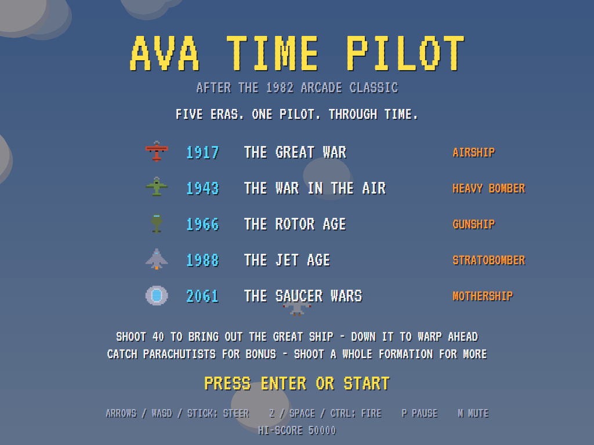 | 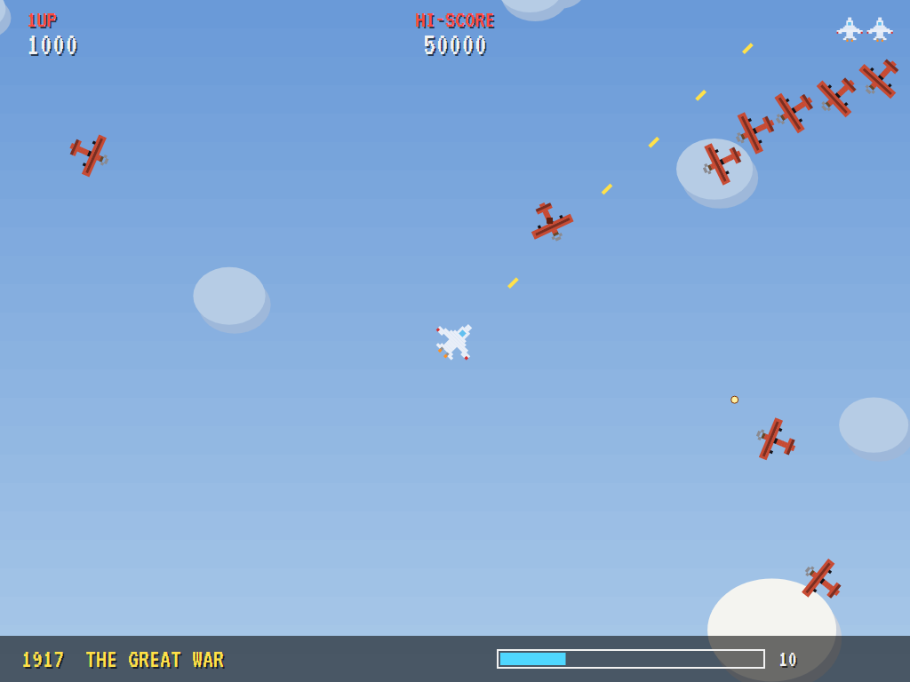 | 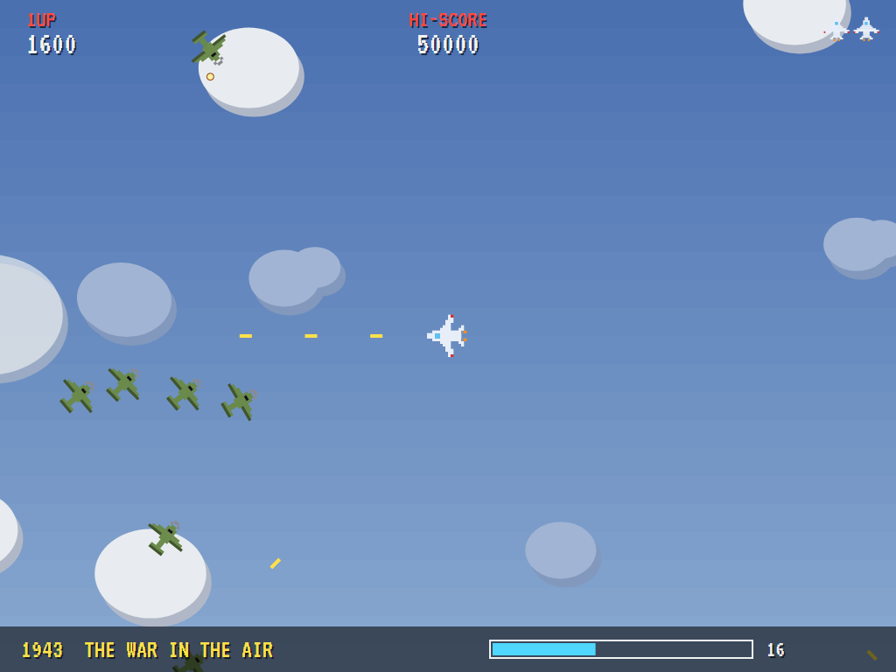 |
| Five eras, one pilot. | Biplanes coming round in a formation. | Fighters over the clouds. |

| 1966 | 1988 | 2061 |
|:----:|:----:|:----:|
| 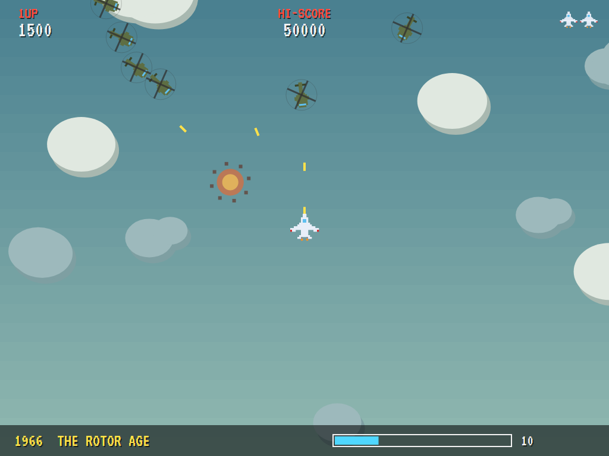 | 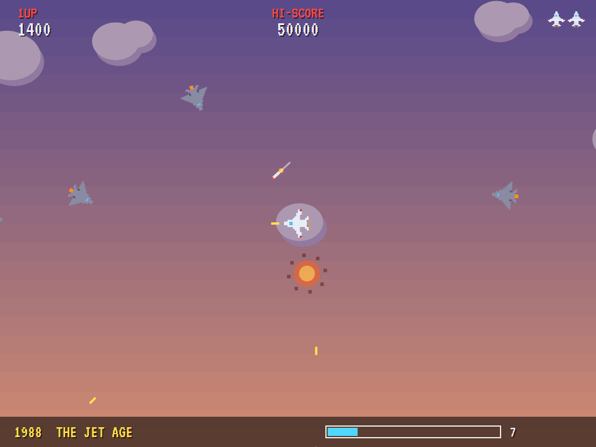 | 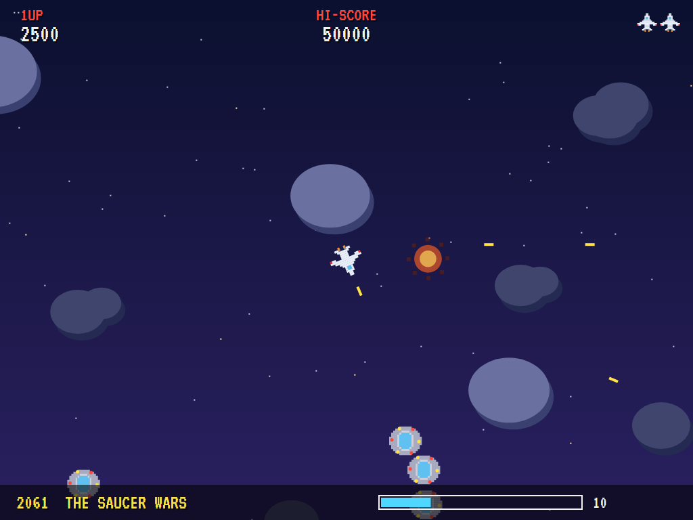 |
| Helicopters, and a missile coming in. | Jets in a sunset sky. | Saucers among the stars. |

| The heavy bomber | The mothership | The time warp |
|:----------------:|:--------------:|:-------------:|
| 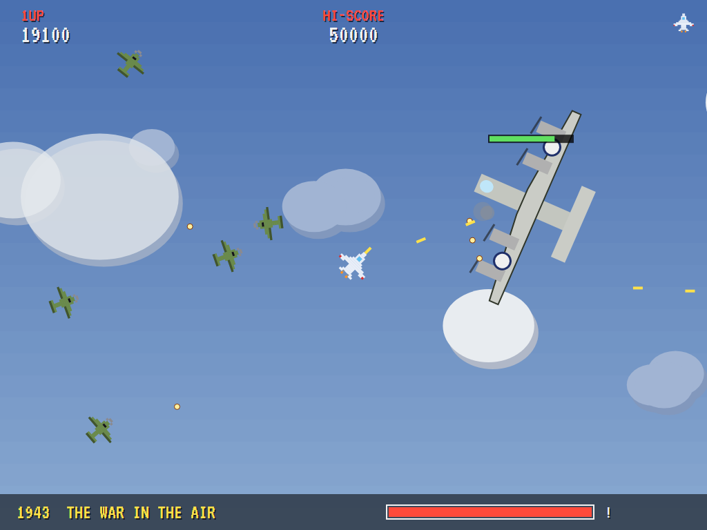 | 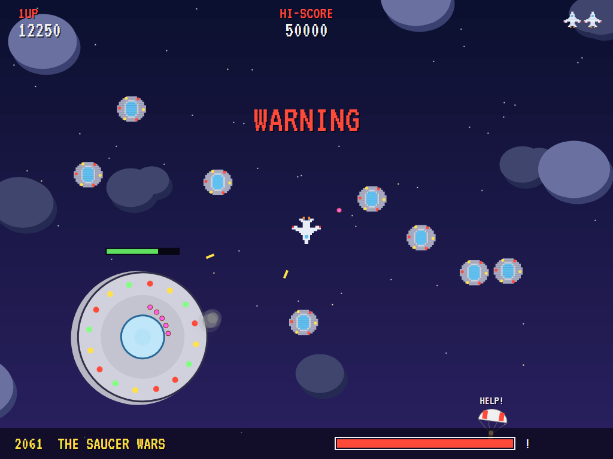 | 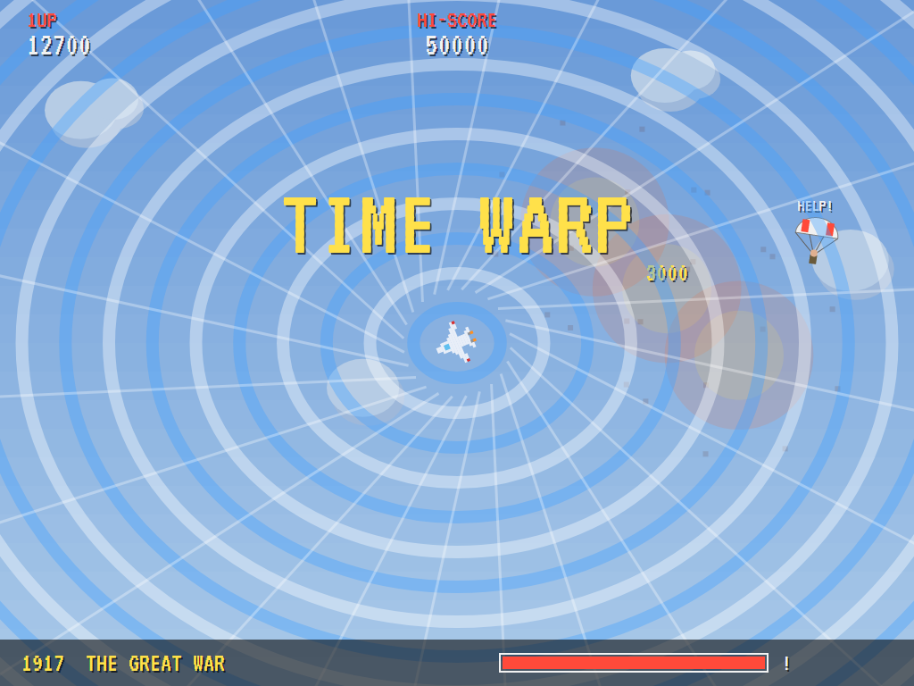 |
| 1943's great ship, under fire. | 2061's, and its saucers. | Through to the next era. |

| A parachutist | The best pilots |
|:-------------:|:---------------:|
| 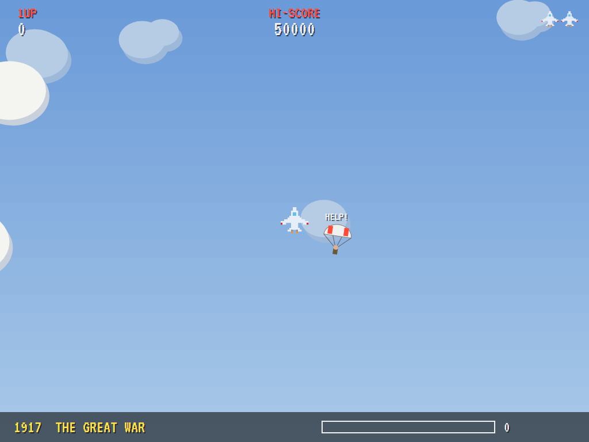 | 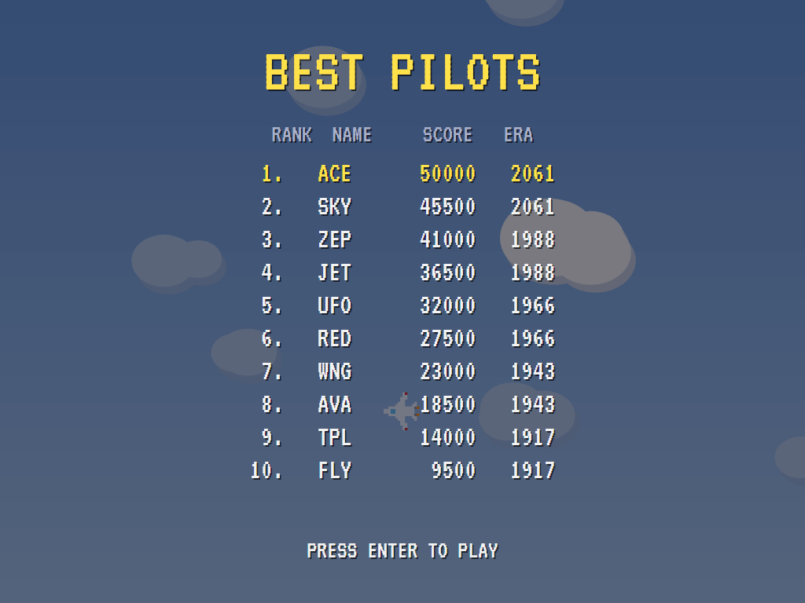 |
| Fly through to catch him. | The high-score table. |

The screenshots are made by the tests, which play the game in a real (headless) window; see
[Tests](#tests).

## Download and run

Ready-to-run builds for Windows, macOS and Linux, on both Intel/AMD and ARM, are on the
[Releases page](https://github.com/Harlock123/AVATimePilot/releases/tag/latest). **Latest build** is
rebuilt on every push to `main`. Each download is one self-contained executable: no .NET install is
needed.

| Platform | Archive |
|---|---|
| Windows | `AVATimePilot-win-x64.zip`, `AVATimePilot-win-x86.zip`, `AVATimePilot-win-arm64.zip` |
| macOS | `AVATimePilot-osx-arm64.tar.gz` (Apple silicon), `AVATimePilot-osx-x64.tar.gz` (Intel) |
| Linux | `AVATimePilot-linux-x64.tar.gz`, `AVATimePilot-linux-arm64.tar.gz`, `AVATimePilot-linux-arm.tar.gz` |

```bash
tar -xzf AVATimePilot-linux-x64.tar.gz     # or linux-arm64, linux-arm, osx-arm64, osx-x64
./AVATimePilot
```

On Windows, unzip and run `AVATimePilot.exe`. On macOS, if Gatekeeper refuses to open it, run
`xattr -d com.apple.quarantine AVATimePilot` once. Run with `--no-audio` for silence.

**Sound** comes through OpenAL Soft, built in for every platform. In a virtual machine the game
detects it and uses a larger audio buffer, so the sound doesn't break up.

**Gamepads** use SDL2, which is bundled for Windows, macOS and Intel/AMD Linux. ARM Linux builds need it
installed; without it the keyboard still works:

```bash
sudo apt install libsdl2-dev            # Debian / Ubuntu / Raspberry Pi OS
sudo pacman -S --needed sdl2-compat     # Arch / Omarchy
```

## Controls

| Input | Action |
|-------|--------|
| **Enter** / **Space** | Start |
| **Arrow keys** / **WASD** / number pad | Steer: the plane turns toward the way you point |
| **Z** / **X** / **Space** / **Ctrl** (hold) | Fire |
| **P** / **Esc** | Pause (Esc again to quit) |
| **M** | Mute |
| **Ctrl+S** / **Cmd+S** | Save a screenshot to the Pictures folder |

**Gamepad**: left stick or D-pad to steer, **A** or **B** to fire, **Start** to start and pause,
**Back** (while paused) to quit.

**Entering initials**: type letters, or dial with **Up**/**Down** and accept with **Space**; **Left** /
**Backspace** go back; **Enter** finishes.

## Scoring

| What | Points |
|---|---:|
| An enemy: biplane or fighter, helicopter, jet, saucer | 100, 100, 150, 200, 250 |
| A homing missile | 150 |
| A whole formation of five | 1,000 bonus |
| A parachutist | 1,000, then 2,000… up to 5,000 |
| The great ship | 3,000, 4,000, 5,000, 6,000, 8,000 |
| Extra plane | at 20,000, then every 60,000 |

Bonuses and great ships are worth more each time round the eras.

## Tests

```bash
dotnet test AVATimePilot.slnx
```

The engine has no UI and runs in fixed 60 Hz steps, so it plays the same at any frame rate, and a seed
always plays the same game. The tests check:

- **Flying**: the sixteen headings, turning a step at a time the short way round, and the plane never
  stopping.
- **Shooting**: shots flying ahead and bringing planes down, and the limit on shots in the air.
- **The era**: forty kills bringing out the great ship, which takes many hits, and downing it to warp
  to the next era. Formation bonuses, rising parachutist bonuses, and homing missiles.
- **Lives**: losing a life and coming back protected, extra planes, game over and the high-score
  table, and the eras coming round again harder.
- **The machine**: enemies, formations and parachutists turning up by themselves, the title, demo
  and table cycle, pausing, and every sound and sprite.

The computer pilot plays the first era with four seeds in them. It must shoot down at least 25 each
time and get through more often than not.

The screenshot tests draw the real screen in a headless window. To refresh the README's pictures:

```bash
TIMEPILOT_SHOTS=$PWD/Images dotnet test tests/AVATimePilot.Tests --filter ScreenshotTests
```

## Building

```bash
dotnet build AVATimePilot.slnx
dotnet run --project src/AVATimePilot
```

Needs the .NET 10 SDK. The sounds are made by `tools/make_sounds.py` (standard-library Python):
`python3 tools/make_sounds.py` rewrites `src/AVATimePilot/Sounds`.

## Project structure

```
AVATimePilot/
├── AVATimePilot.slnx
├── src/AVATimePilot/
│   ├── Engine/
│   │   ├── GameEngine.cs        # States, the title and demo cycle, lives and the music
│   │   ├── GameEngine.Play.cs   # Flying and shooting, enemies and their passes, formations,
│   │   │                        # missiles, parachutists, the great ships and the time warp
│   │   ├── Eras.cs              # The five eras: skies, craft, great ships, speeds and scores
│   │   ├── Entities.cs, Geometry.cs
│   │   ├── AttractPilot.cs      # The computer pilot for the demonstration (and the tests)
│   │   ├── HighScoreTable.cs, InitialsEntry.cs
│   │   ├── InputHandler.cs, ControllerManager.cs  # Keys and an SDL2 gamepad
│   │   └── SoundManager.cs      # Effects, the flying music and the tunes through OpenAL
│   ├── Audio/                   # The OpenAL engine (from the author's AVABand)
│   ├── Views/                   # The sky, clouds, planes, great ships, the warp, and the screens
│   └── Sounds/                  # The synthesised effects and tunes
├── tests/AVATimePilot.Tests/    # Gameplay and screenshot tests
├── tools/make_sounds.py
└── Images/                      # Screenshots
```

## About and licence

AVATimePilot © 2026 Lonnie Watson, under the [MIT License](LICENSE).

*Time Pilot* © 1982 Konami; the name belongs to its current owner. AVATimePilot is an independent,
unofficial game in its style. Its eras, craft, graphics, sounds, tunes and code are its own; nothing
is taken from the arcade machine's program, graphics, sound or music. It is not affiliated with or
endorsed by any rights holder.
